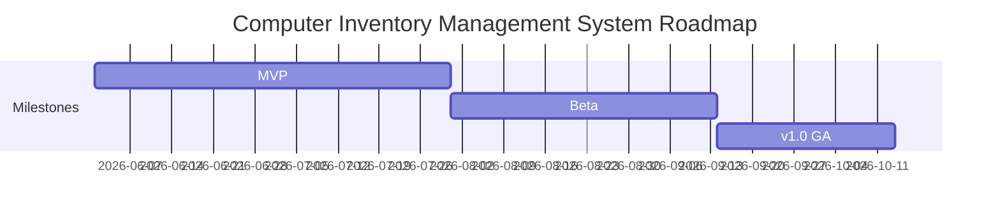

# Product Roadmap

> **Status:** 🟢 Complete · **Owner:** MKSWORKS · **Last updated:** 2026-07-14

A roadmap communicates **direction and priorities over time** — not exact dates.
Revisit it regularly.

## Now / Next / Later

### 🚀 Now (current cycle)
- [x] JWT REST API with role-based access (Admin/Technician/Viewer) — secure core (G1)
- [x] Thin-client agent: auto-registration, hardware detection, heartbeat — automated discovery (G1, G2)
- [ ] Blazor dashboard: search, filter, edit inventory with live status — real-time visibility (G2, G4)

### ⏭️ Next (upcoming)
- [ ] Automatic loaner check-in/out with idle-timeout auto-checkout — reduce lost devices (G3)
- [ ] User & maintenance management (departments, history) plus full audit trail — accountability (G3)
- [ ] Docker Compose deployment (API, Web, SQL Server 2025) with seeded admin — fast onboarding (G4)

### 🔮 Later (future / exploratory)
- [ ] Alerts for offline or overdue devices — proactive tracking (G3)
- [ ] Reporting and CSV export — reporting
- [ ] SSO / Active Directory integration for staff login — onboarding (G4)
- [ ] macOS / Linux loaner agents — expand fleet coverage

## Release Timeline

## Milestones

| Milestone | Target | Goal / Definition of Done | Status |
|-----------|--------|---------------------------|--------|
| MVP | Q3 2026 | All **Must** features live: JWT API, agent auto-register/heartbeat, dashboard, audit trail; CI green | In progress |
| Beta | Q4 2026 | Docker deploy, auto check-in/out, user & maintenance management; piloted on a live loaner fleet | Planned |
| v1.0 GA | Q1 2027 | ≥ 95% agent coverage, offline/overdue alerts, no critical defects, deployment & user guides published | Planned |

## Themes

Group initiatives under strategic themes and tie them back to
[Vision & Scope](vision-and-scope.md) goals.

| Theme | Related Goal | Initiatives |
|-------|--------------|-------------|
| Automated discovery | G1 | Thin-client agent, hardware detection, auto check-in/out |
| Real-time visibility | G2 | Periodic heartbeats, live dashboard, status indicators |
| Accountability | G3 | Audit trail, location tracking, offline/overdue alerts |
| Fast onboarding | G4 | Blazor dashboard, script/GPO install, Docker Compose with seeded admin |

## Out of Scope / Not Doing

Explicitly list what you've decided **not** to pursue and why, to prevent churn.

| Not Doing | Why |
|-----------|-----|
| Non-Windows agents (macOS/Linux) & mobile-native apps | Fleet is Windows-only this release; revisit later |
| Software-license & asset-lifecycle management | Focus is hardware inventory, not licensing |
| Remote control / remote support tooling | Handled separately (e.g., RustDesk) |
| Procurement, purchasing & financial/depreciation tracking | Outside the product's inventory focus |
