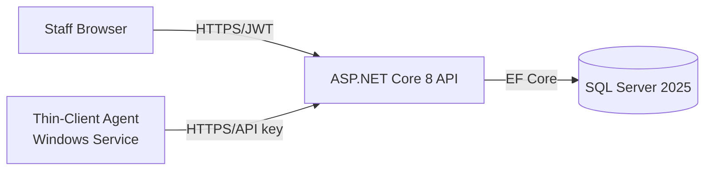

# Software Requirements Specification (SRS)

> **Status:** 🟢 Complete · **Owner:** MKSWORKS · **Last updated:** 2026-07-14
>
> Structure based on IEEE 830 / ISO/IEC/IEEE 29148.

## 1. Introduction

### 1.1 Purpose
This SRS defines the functional and non-functional requirements for the Computer
Inventory Management System (CIMS). It is written for the development team, QA,
and IT stakeholders responsible for building, verifying, and operating the
system. It complements the [PRD](product-requirements-document.md), which
captures business intent, by making requirements atomic and testable.

### 1.2 Scope
CIMS is a self-hosted platform for tracking 200+ organizational computers and
loaner devices. It comprises an ASP.NET Core 8 REST API, a Blazor WebAssembly
dashboard, and .NET 8 Windows Service thin-client agents that auto-register
hardware, send periodic heartbeats, and automate loaner check-in/out. It
provides role-based access, audit trails, maintenance history, and Docker-based
deployment. **Out of scope:** non-Windows agents, mobile-native apps,
software-license / asset-lifecycle management, remote-control tooling, and
procurement / financial tracking.

### 1.3 Definitions, Acronyms, Abbreviations
| Term | Definition |
|------|------------|
| CIMS | Computer Inventory Management System |
| Agent / Thin Client | Windows Service on a loaner PC that auto-registers hardware and reports status |
| Heartbeat | Periodic signal (~5 min) from an agent reporting online status |
| Check-in / Check-out | Loaner assignment lifecycle event; auto check-out is triggered by idle timeout |
| JWT | JSON Web Token used for API authentication |
| RBAC | Role-Based Access Control (Admin, Technician, Viewer) |
| Blazor WASM | Blazor WebAssembly client-side UI framework |
| EF Core | Entity Framework Core (ORM) |

### 1.4 References
- [Product Requirements Document](product-requirements-document.md), [Vision & Scope](vision-and-scope.md), [User Stories](user-stories.md)
- [Architecture](../phase-2-design/architecture.md), [Data Model](../phase-2-design/data-model.md), [API Specification](../phase-2-design/api-specification.md)
- [Test Plan](../phase-4-testing/test-plan.md), [Deployment Guide](../phase-5-deployment/deployment-guide.md), [Threat Model](../security/threat-model.md)
- IEEE 830 / ISO/IEC/IEEE 29148 (SRS structure)

## 2. Overall Description

### 2.1 Product Perspective
CIMS is a new, standalone, self-hosted system that replaces spreadsheet-based
tracking. It is a three-tier application: a Blazor WASM client calls an
ASP.NET Core 8 API, which persists to SQL Server 2025 (Docker) via EF Core.
Loaner PCs run a .NET 8 Windows Service agent that communicates with the API
over HTTPS using an agent API key.

### 2.2 Product Functions
- Authenticate users and authorize actions by role.
- Manage computer inventory records (CRUD, search, filter).
- Auto-register agents and ingest hardware details.
- Receive heartbeats and derive online / offline status.
- Automate loaner check-in / out with idle-timeout auto-checkout.
- Manage users, departments, locations, and ownership assignments.
- Record maintenance schedules and history.
- Maintain an audit trail of all changes.
- Present a status dashboard with reporting / export.

### 2.3 User Characteristics
| Role | Expertise | Access |
|------|-----------|--------|
| Administrator | IT admin | Full control: users, agents, delete, audit |
| Technician | IT operations | View / edit inventory, maintenance, assignments |
| Viewer (Help Desk / Manager) | Non-technical | Read-only lookup of status, location, assignment |
| Loaner Agent | System actor (no human) | Register, heartbeat, check-in / out via API key |

### 2.4 Constraints
- Agents are Windows-only (.NET 8 Windows Service).
- Server stack fixed to .NET 8, SQL Server 2025, and Docker.
- Client requires a modern browser with WebAssembly support.
- TLS required in transit; secrets supplied via environment variables.
- Self-hosted deployment (no external cloud dependency).
- UI must meet WCAG 2.1 AA color-contrast and keyboard-navigation.

### 2.5 Assumptions & Dependencies
- Loaner PCs run Windows and permit service install via script / GPO.
- Network connectivity exists between agents / clients and the API.
- A Docker host is available for deployment.
- Depends on the .NET 8 runtime, SQL Server 2025, and EF Core.

## 3. Functional Requirements

Each requirement is **atomic, testable, and uniquely identified**. Priority uses
MoSCoW. Traceable to PRD requirements (PR-#).

| ID | Requirement | Priority | Acceptance Criteria |
|----|-------------|----------|---------------------|
| FR-1 | The system shall authenticate users by credentials and issue a signed JWT. | Must | Given valid credentials, when a user logs in, then a JWT is returned; invalid credentials return 401. |
| FR-2 | The system shall enforce RBAC across Admin, Technician, and Viewer roles. | Must | Given a Viewer token, when a delete is attempted, then 403 is returned. |
| FR-3 | The system shall create, read, update, and delete computer records (serial, hostname, IP, location, status, assigned user). | Must | Given a Technician, when a computer with a unique serial is created, then it is persisted and returned with an ID. |
| FR-4 | The system shall let users search and filter inventory by hostname, serial, status, and location. | Must | Given 200+ records, when filtering by status=online, then only online devices are listed. |
| FR-5 | The system shall let a thin-client agent auto-register using an agent API key. | Must | Given a valid API key, when the agent posts hardware, then a record is created or matched by serial. |
| FR-6 | The agent shall detect serial, CPU, RAM, storage, and network information. | Must | When the agent registers, then the record includes non-empty hardware fields. |
| FR-7 | The system shall accept periodic heartbeats and update last-seen / online status. | Must | Given an agent, when a heartbeat is received, then last-seen updates and status=online. |
| FR-8 | The system shall mark a device offline when no heartbeat arrives within the configured threshold. | Must | Given no heartbeat for > threshold, when status is evaluated, then status=offline. |
| FR-9 | The system shall record loaner check-in and check-out events with user and timestamp. | Must | When a device is checked out, then an event with actor and timestamp is stored. |
| FR-10 | The system shall auto check-out a loaner after a configurable idle timeout. | Must | Given idle > timeout, when evaluated, then the device is checked out automatically. |
| FR-11 | The system shall assign devices to users and departments (ownership). | Should | Given a Technician, when a device is assigned to a user, then the ownership is recorded. |
| FR-12 | The system shall record maintenance schedules and history per device. | Should | When a maintenance entry is added, then it appears in the device history. |
| FR-13 | The system shall log all inventory changes with actor, timestamp, and change detail. | Must | When a record is edited, then an audit entry captures who, when, and what changed. |
| FR-14 | The system shall manage user accounts with department assignment and invite codes. | Should | Given an Admin, when a user is invited, then a valid invite code grants scoped registration. |
| FR-15 | The system shall present a dashboard summarizing device counts and status. | Must | When the dashboard loads, then online / offline and checked-in / out counts are shown. |
| FR-16 | The system shall export inventory to CSV. | Could | When export is requested, then a CSV of the filtered set is produced. |
| FR-17 | The system shall alert on offline or overdue devices. | Could | Given a device offline > threshold, when alerts run, then it is flagged. |
| FR-18 | The agent shall queue and retry reports when the server is unreachable. | Must | Given the API is down, when heartbeats fail, then reports are queued and resent on recovery. |

## 4. Non-Functional Requirements

| ID | Category | Requirement | Target |
|----|----------|-------------|--------|
| NFR-1 | Performance | Dashboard list p95 latency for 200+ devices | < 500 ms |
| NFR-2 | Performance | Agent heartbeat interval | every 5 min |
| NFR-3 | Scalability | Concurrent agents / records without redesign | ≥ 200 agents / 500+ records |
| NFR-4 | Availability | Server uptime during business hours | ≥ 99.5% |
| NFR-5 | Security | Auth, authorization, transport, secrets | JWT + RBAC + agent API key; TLS in transit; secrets via env vars |
| NFR-6 | Reliability | Agent behavior when server unreachable | Retry + local queue, no data loss |
| NFR-7 | Usability | Accessibility and onboarding | WCAG 2.1 AA; time-to-first-use < 30 min |
| NFR-8 | Maintainability | Automated tests and CI | CI green on all Must-priority features |
| NFR-9 | Compliance | Audit logging of changes | All changes logged (retention policy TBD) |
| NFR-10 | Portability | Deployment | Docker Compose (API, Web, SQL Server) |

## 5. External Interface Requirements

- **User interfaces:** Blazor WASM dashboard over HTTPS; Swagger UI for API
  exploration; keyboard-navigable and WCAG 2.1 AA compliant.
- **Hardware interfaces:** the agent reads local hardware (via WMI) for serial,
  CPU, RAM, storage, and network adapters.
- **Software interfaces / APIs:** REST / JSON API secured by JWT (staff) and an
  agent API key (agents); EF Core to SQL Server 2025. See the
  [API Specification](../phase-2-design/api-specification.md).
- **Communication interfaces:** HTTPS / TLS with JSON payloads; default ports
  API 5000, Web 5001, SQL Server 1433.

## 6. Data Requirements

Reference the [Data Model](../phase-2-design/data-model.md). Core entities:
`Computer`, `ComputerAgentStatus`, `ComputerHistory`, `ComputerOwnership`,
`ComputerGeoLocation`, `ComputerUpdateRequest`, `ApplicationUser`, `Department`,
`Location`, `AppSetting`, and `InviteCode`, plus an audit log.

- **Integrity:** unique serial / hostname; FK-enforced relationships; agent
  status keyed to its computer.
- **Privacy:** stores device and assignment data with minimal PII (usernames,
  departments); all writes are audited.
- **Retention:** audit and heartbeat-history retention is TBD (open question in
  the [PRD](product-requirements-document.md)).

## 7. Verification

| Method | Applies to | Detail |
|--------|-----------|--------|
| Test | FRs, NFR-1..3 | Automated unit / integration tests (`ComputerInventory.Tests`); CI must be green. |
| Demonstration | FR-5..10 | Agent installs and auto-registers on a clean loaner PC. |
| Inspection | NFR-5, NFR-8 | Code review and security review against the [Threat Model](../security/threat-model.md). |
| Analysis | NFR-1..4 | Latency / load measurement and availability review. |

Release requires CI green, all Must requirements passing, and no open
critical / high defects. Cross-reference the [Test Plan](../phase-4-testing/test-plan.md).

## 8. Appendices

- **Traceability:** PR-# ([PRD](product-requirements-document.md)) → FR-# / NFR-#
  (this SRS) → test cases ([Test Plan](../phase-4-testing/test-plan.md)).
- **Related design:** [Architecture](../phase-2-design/architecture.md),
  [Data Model](../phase-2-design/data-model.md),
  [API Specification](../phase-2-design/api-specification.md).
- **Open items:** macOS / Linux agents, audit / heartbeat retention, and
  SSO / AD integration (see PRD §10).
