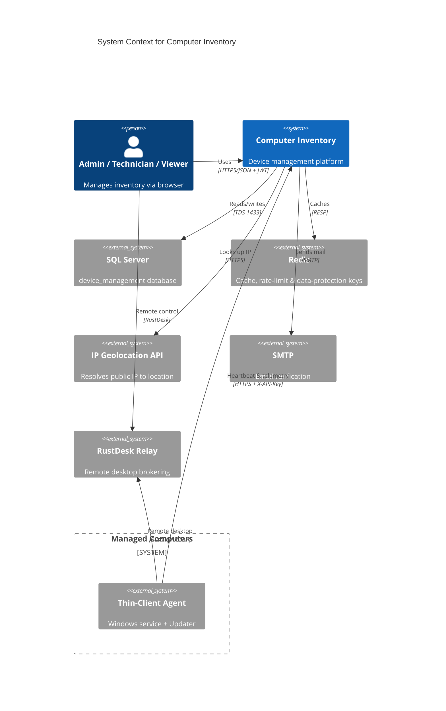
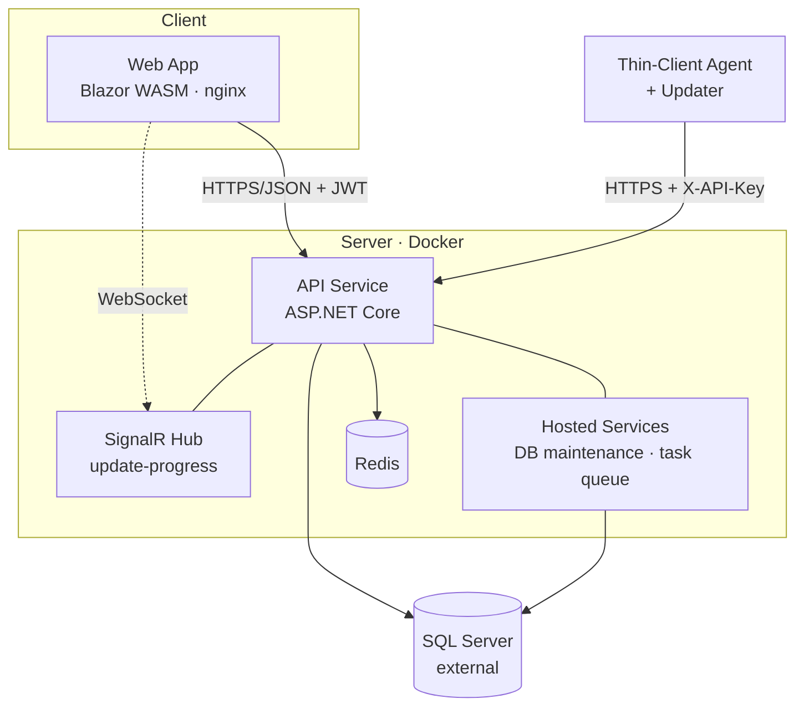

# Software Architecture Document (SAD)

> **Status:** 🟢 Complete · **Owner:** Engineering · **Last updated:** 2026-07-14
>
> Organized loosely around the [C4 model](https://c4model.com/) and the
> [arc42](https://arc42.org/) template.

## 1. Introduction & Goals

Computer Inventory is a device-management platform: a **Blazor WebAssembly** admin
UI, an **ASP.NET Core** API, and unattended **Windows thin-client agents** that
report telemetry, self-update, and expose remote-desktop access. Top quality goals:

| Quality Goal | Scenario | Priority |
|--------------|----------|----------|
| Security | Agents and users authenticate; least-privilege roles; secrets never leak | High |
| Reliability | Transient DB/HTTP failures retried; agent updates roll back on failure | High |
| Performance | Frequent agent heartbeats served with caching + compression at low cost | High |
| Observability | Every request traceable (correlation id, structured logs, health probes) | Medium |
| Maintainability | Clean-architecture layering keeps domain independent of infrastructure | Medium |

## 2. Constraints

- **Agents are Windows-only** (`[SupportedOSPlatform("windows")]`, WMI/`System.Management`).
- **SQL Server** is the system of record (external instance, TDS/1433); data access
  is predominantly via **stored procedures**.
- **.NET 8** across all projects; **Docker** for server-side deployment.
- Agents typically sit **behind NAT** → a **pull-based heartbeat** model (no inbound
  connections to agents); remote desktop is brokered through a **RustDesk relay**.
- The Web client is a static **SPA** (no server-side rendering); all state via the API.

## 3. Context & Scope (C4: Level 1)

## 4. Container View (C4: Level 2)

Containers: **Web** (static SPA served by nginx), **API** (controllers, services,
SignalR hub, and in-process hosted workers), **Redis** (distributed cache, rate-limit
store, data-protection keyring), **SQL Server** (external), and the **Agent + Updater**
running as a Windows service on each managed computer.

## 5. Component View (C4: Level 3)

**API** (`ComputerInventory.Api`) — 19 controllers (Agent, Auth, Computers,
Packages, SystemDetails, RestorePoint, Maintenance, Map, Users, Dashboard, Health, …)
over a service layer:

- **Services:** `PackageService`, `GeoLocationService` (Polly retry + token-bucket),
  `AuthService`, `EmailService`, `InstallTokenService`, `InviteCodeService`,
  `ErrorAnalyzerService`, cache services, and update/version info caches.
- **Hosted services:** `DatabaseMaintenanceService` (offline sweep, retention
  cleanup) and `BackgroundTaskQueueProcessor`.
- **Middleware pipeline:** GlobalException → SecurityHeaders → HTTPS redirect →
  CorrelationId → RequestTiming → ResponseCompression → Serilog request logging →
  CORS → RateLimiting (incl. agent `X-API-Key`) → AuthN → AuthZ.
- **Authorization:** role policies (`AdminOnly`, `TechnicianOrAdmin`, `AllUsers`)
  plus a `ComputerAuthorizationHandler` for per-computer department/ownership scope.
- **Realtime:** `UpdateProgressHub` at `/hubs/update-progress`.

**Infrastructure** (`ComputerInventory.Infrastructure`) — ~19 repositories and
`ApplicationDbContext` (EF Core, snake_case, retry-on-failure), executing stored
procedures. **Core** holds entities + interfaces; **Contracts** holds DTOs shared by
the Web app and agent. See the [Component Diagram](diagrams.md#component-diagram).

## 6. Runtime / Behavior

Key scenarios (sequence diagrams in [Diagrams](diagrams.md)):

- **Agent check-in & telemetry** — register → heartbeat (geo resolution, command
  flags) → submit system details / restore points.
- **Agent auto-update** — resolve target package → download + SHA-256 verify → apply
  via external Updater with backup/rollback; progress streamed to the UI over SignalR.
  See [Technical Design](technical-design.md).
- **User login** — credentials → JWT issued in an httpOnly cookie + rotating refresh
  token; brute-force lockout via `LoginRateLimiter`.

## 7. Deployment View

Docker Compose runs `INV-MKS-Redis`, `INV-MKS-API` (`:5010→8080`, persisted
DataProtection keys volume) and `INV-MKS-Web` (`:5011→8080`, nginx) on the
`INV-MKS-Default` bridge network; SQL Server is external. A Linux relay uses **SSLH**
on `:21118` to share one port between the HTTP API and RustDesk. See the
[Deployment Diagram](diagrams.md#deployment-diagram) and
[Deployment Guide](../phase-5-deployment/deployment-guide.md).

## 8. Cross-Cutting Concepts

- **Persistence:** EF Core + stored procedures on SQL Server; snake_case; connection
  resiliency (`EnableRetryOnFailure`, 60s command timeout, query splitting);
  soft-delete and `row_version` optimistic concurrency (see [Data Model](data-model.md)).
- **Security:** JWT bearer (from `Authorization` header, httpOnly cookie, or SignalR
  query string); role policies + per-computer handler; agent `X-API-Key`; login
  brute-force lockout and request rate limiting; `PasswordValidator`; persisted
  DataProtection keys; security-headers middleware; HTTPS redirect; fail-fast startup
  config validation and a dev-mode-in-container guard. Link to
  [Threat Model](../security/threat-model.md).
- **Error handling & logging:** `GlobalExceptionMiddleware` returns RFC-7807
  Problem Details; **Serilog** structured logging + request logging; per-request
  correlation id echoed as `X-Correlation-Id`.
- **Configuration:** `appsettings.json` + environment variables / `.env`; strongly
  typed options; required keys validated at startup.
- **Observability:** liveness/readiness probes at `/health/live` and `/health/ready`;
  request-timing headers; download/adoption counters. Link to
  [Monitoring](../phase-6-operations/monitoring.md).

## 9. Architectural Decisions

Significant decisions are captured as [ADRs](adr/README.md). Notable choices:
clean-architecture layering; stored-procedure-first data access; database-backed
package registry (vs single `update.json`); pull-based agent model behind NAT;
Blazor WASM SPA with JWT-in-cookie; Redis-optional (falls back to in-memory).

## 10. Quality Requirements

- **Performance:** heartbeat path avoids disk I/O via update/version caches; Brotli/
  Gzip response compression; distributed cache; filtered indexes on hot queries.
- **Security:** least-privilege roles; secrets validated and never logged; short-lived
  single-use install tokens; invite-gated registration.
- **Reliability:** EF + Polly retries; background task queue; updater rollback and
  multi-URL failover; offline detection reconciles stale agent state.
- **Scalability:** stateless API behind the cache; SQL Server is the throughput anchor.

## 11. Risks & Technical Debt

| Item | Impact | Plan |
|------|--------|------|
| SignalR has no Redis backplane | Blocks horizontal scale-out of the API | Add `AddStackExchangeRedis` backplane before running >1 API replica |
| Dual update paths (registry + legacy `update.json`) | Extra code paths to maintain/test | Retire the legacy fallback once all agents are on the registry |
| Packages verified by checksum only (unsigned) | Trust depends on transport/server integrity | Introduce package code-signing (see technical-design open questions) |
| External SQL Server is a single dependency | Availability/throughput bottleneck | HA/failover + retention jobs already in place; monitor |

## 12. Glossary

| Term | Definition |
|------|------------|
| Agent / Thin-Client | Windows service on a managed computer that reports inventory and self-updates |
| Updater | Standalone exe that applies agent updates outside the service (backup/rollback) |
| Heartbeat | Periodic agent → API check-in carrying version, user, IP, and command flags |
| System Details | Full hardware/software snapshot collected from a computer |
| Restore Point | Point-in-time compressed configuration snapshot of a computer |
| Package / Channel | A versioned agent build; channel = stable/beta/canary rollout track |
| Distribution Rule | Targets a package to all / serial / department / location |
| Install Token / Invite Code | Short-lived install-script access / registration gate |
| SSLH · RustDesk | Port-sharing multiplexer · remote-desktop relay used for remote control |

