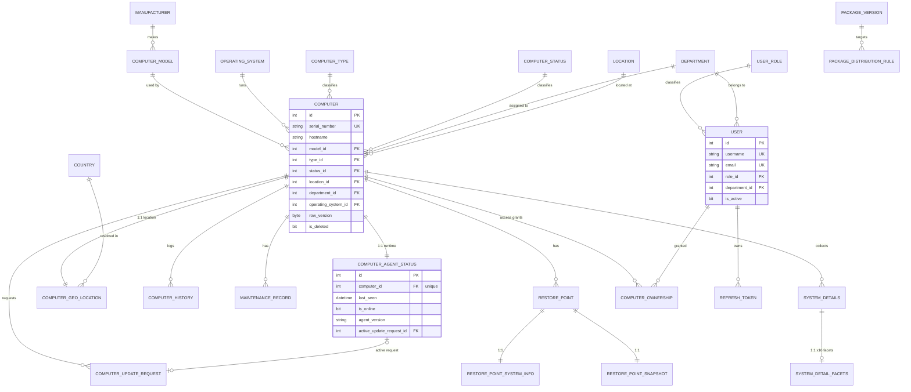

# Data Model

> **Status:** 🟢 Complete · **Owner:** Engineering · **Last updated:** 2026-07-14

## 1. Overview

The system persists computer/device inventory, agent telemetry, maintenance,
restore points, packaging, and authentication data in a single **Microsoft SQL
Server** database (`device_management`).

Design principles:

- **EF Core model is the source of truth**; the DDL
  ([ComputerInventory_DDL.sql](../ComputerInventory_DDL.sql)) is generated from it
  and consolidated from migrations 001–048.
- **3NF normalization** — lookups and reference data are extracted into their own
  tables rather than free-text columns.
- **snake_case** table/column naming (EF Core convention with pluralization).
- **Lookup PKs mirror C# enum integer values** for seamless FK ↔ enum mapping.
- **Soft delete** (`is_deleted` / `deleted_at`) on user-facing entities.
- **Optimistic concurrency** via `row_version` (`ROWVERSION`) tokens.
- **Audit columns** (`created_at`, `updated_at`, `created_by`, `updated_by`).
- **Volatile agent runtime state is split 1:1** out of `computers` into
  `computer_agent_statuses`, keeping the inventory row stable.
- Data access is primarily through **stored procedures** (100+) invoked via
  `Microsoft.Data.SqlClient`.

## 2. Entity-Relationship Diagram

## 3. Entities

Column tables list the notable columns; every user-facing entity also carries the
standard audit/soft-delete/concurrency columns described in §1.

### 3.1 Lookup tables (enum-backed, `id` = C# enum value)

All share the shape `(id INT PK, name NVARCHAR(50) UNIQUE, created_at, updated_at)`
and use **manually assigned IDs** (not `IDENTITY`).

| Table | Purpose | Seed values |
|-------|---------|-------------|
| computer_types | Device classification | Desktop, Laptop, Server, Workstation, Tablet, Other |
| computer_statuses | Inventory lifecycle | Unassigned, Assigned, InMaintenance, Retired, Lost, Stolen, Disposed |
| update_statuses | Agent update progress | None, Pending … Completed, Failed |
| maintenance_types | Maintenance category | Repair, Upgrade, Cleaning, SoftwareUpdate, HardwareReplacement, Inspection, Other |
| maintenance_statuses | Maintenance lifecycle | Scheduled, InProgress, Completed, Cancelled |
| restore_point_types | Snapshot trigger | Reboot, Scheduled, Manual, Initial, PreChange, PostChange |
| version_types | Release channel target | Server, ThinClient |
| user_roles | Authorization role | Viewer, Technician, Admin |

### 3.2 Reference / normalized tables

All share `(id INT IDENTITY PK, name, created_at, updated_at)` unless noted.

| Table | Notable columns | Description |
|-------|-----------------|-------------|
| departments | name UNIQUE | Org units for computers/users |
| locations | name UNIQUE (200) | Physical sites |
| manufacturers | name UNIQUE | Hardware vendors |
| computer_models | manufacturer_id FK, model_name | Unique per `(manufacturer_id, model_name)` |
| operating_systems | name UNIQUE | OS catalog |
| countries | name UNIQUE, country_code UNIQUE | Geo-lookup reference |

### 3.3 `computers` (core inventory)

| Column | Type | Constraints | Description |
|--------|------|-------------|-------------|
| id | INT | PK, IDENTITY | Unique identifier |
| serial_number | NVARCHAR(100) | NOT NULL, UNIQUE | Hardware serial |
| hostname | NVARCHAR(100) | NOT NULL | Machine name |
| ip_address / mac_address | NVARCHAR(45/17) | NULL | Last known network identity |
| model_id | INT | NOT NULL, FK → computer_models | Make/model |
| operating_system_id | INT | NULL, FK → operating_systems | Installed OS |
| processor / ram_gb / storage_gb | mixed | NULL | Static specs |
| type_id | INT | NOT NULL, FK → computer_types | Device type |
| status_id | INT | NOT NULL, FK → computer_statuses | Lifecycle status |
| location_id / department_id | INT | NULL, FK | Assignment |
| notes | NVARCHAR(2000) | NULL | Free text |
| purchase_date | DATETIME2 | NOT NULL | Procurement date |
| warranty_expiration | DATETIME2 | NULL | Warranty end |
| purchase_price | DECIMAL(18,2) | NULL | Cost |
| assigned_to | NVARCHAR(200) | NULL | Manual assignee text |
| created_at/updated_at/created_by/updated_by | audit | — | Audit trail |
| row_version | ROWVERSION | NOT NULL | Concurrency token |
| is_deleted / deleted_at | soft-delete | — | Soft delete |

### 3.4 Agent runtime & telemetry (per computer)

| Table | Cardinality | Purpose |
|-------|-------------|---------|
| computer_agent_statuses | 1:1 | Volatile agent state: `last_seen`, `is_online`, `current_user`, `has_agent`, `public_ip_address`, `agent_version`, `agent_session_id`, `heartbeat_interval_minutes`, command flags (`force_update`, `force_reinstall`, `reinstall_attempted`, `request_immediate_checkin`), `preferred_location_source`, `active_update_request_id` FK |
| computer_update_requests | 1:N | Historical agent update log: `update_status_id` FK, `update_progress`, `update_status_message`, `update_started_at`, `update_error_logs`, `update_requested_by`, `previous_agent_version` |
| computer_geo_locations | 1:1 | GPS + IP geolocation, resolved `city/region/country_id`, `isp`, `timezone`, `location_source`, `lookup_successful` |
| computer_histories | 1:N | Audit of field changes: `action`, `old_value`, `new_value`, `changed_by`, `changed_at` |

### 3.5 `maintenance_records`

`computer_id` FK, `type_id` FK, `description`, `scheduled_date`, `completed_date`,
`cost DECIMAL(18,2)`, `performed_by`, `status_id` FK, plus audit/soft-delete/`row_version`.

### 3.6 Restore points

| Table | Cardinality | Purpose |
|-------|-------------|---------|
| restore_points | 1:N per computer | Metadata: `restore_point_id UNIQUEIDENTIFIER UNIQUE`, `type_id` FK, `data_size_bytes`, `data_hash`, `is_complete`, `error_message` |
| restore_point_system_infos | 1:1 | Point-in-time host summary (hostname, serial, uptime, user) |
| restore_point_snapshots | 1:1 | 21 GZip-compressed `VARBINARY(MAX)` JSON columns (software, processes, services, drivers, firewall, etc.) |

### 3.7 System details

`system_details` (`computer_id` FK, `collected_at`, `machine_guid`, `product_id`)
is the parent for **16 facet sub-tables** in a 1:1 relationship, each keyed by
`system_detail_id` with `ON DELETE CASCADE`:

`system_detail_bios`, `_motherboards`, `_cpus`, `_memories`, `_storages`, `_gpus`,
`_networks`, `_oses`, `_securities`, `_batteries`, `_chasses`, `_softwares`,
`_users_groups`, `_peripherals`, `_event_logs`, `_performances`.

### 3.8 Authentication & administration

| Table | Notable columns | Description |
|-------|-----------------|-------------|
| users | username UK, email UK, password_hash, first_name, last_name, department_id FK, role_id FK, is_active, is_email_verified, email_verification_token(+expiry), last_login_at | Application accounts (BCrypt hashes) |
| refresh_tokens | user_id FK, token_hash, expires_at, consumed_at, revoked_at, family | JWT refresh rotation |
| install_tokens | token_hash, expires_at, consumed_at, created_by | Short-lived single-use install-script access |
| invite_codes | code_hash, expires_at, max_uses, use_count, is_revoked, note | Registration gating |
| computer_ownerships | computer_id FK, user_id FK, access_level (0=Viewer,1=Manager,2=Owner), granted_by | Per-computer ACL; UNIQUE `(computer_id, user_id)` |

### 3.9 Packaging & versioning

| Table | Notable columns | Description |
|-------|-----------------|-------------|
| package_versions | version, package_type, file_name, storage_path, checksum, file_size, status (Draft→Archived), channel, is_required, is_breaking_change, minimum_agent_version, download_count | Distributable agent/thin-client packages; UNIQUE `(version, package_type)` |
| package_distribution_rules | package_version_id FK, rule_type (AllComputers/BySerial/ByDept/ByLocation), target_value, is_enabled | Targeted rollout rules |
| version_histories | version, type_id FK, change_log, released_at, is_current_version, checksum, file_size | Release/changelog log; UNIQUE `(type_id, version)` |

### 3.10 `app_settings`

Key-value store: `key NVARCHAR(128) PK`, `value NVARCHAR(1024)`, `updated_at`.

## 4. Relationships

- **Cardinality:** `computers` is the aggregate root. It has **1:1** links to
  `computer_agent_statuses` and `computer_geo_locations`, and **1:N** links to
  update requests, history, maintenance, restore points, and system details.
- **Referential integrity — CASCADE:** child rows owned by a computer
  (agent status, geo, history, maintenance, restore points + their children,
  system details + 16 facets, ownerships, update requests) are deleted with the
  parent. `refresh_tokens` and `package_distribution_rules` also cascade.
- **Referential integrity — NO ACTION:** all FKs to **lookup and reference
  tables** (types, statuses, models, OS, departments, locations, countries,
  roles) restrict deletion to protect shared reference data. Cascade paths were
  unified in migration 027.
- `computer_agent_statuses.active_update_request_id` → `computer_update_requests`
  is **NO ACTION** to avoid a multi-cascade-path cycle.

## 5. Indexes & Performance

| Table | Index | Columns | Purpose |
|-------|-------|---------|---------|
| computers | ix_computers_serial_number | serial_number (UNIQUE) | Agent check-in lookup |
| computers | ix_computers_hostname | hostname | Search |
| computers | ix_computers_status_id / _type_id / _model_id / _department_id / _location_id / _operating_system_id | FK columns | Filtered list queries |
| computers | ix_computers_is_deleted | is_deleted (filtered `= 0`) | Skip soft-deleted rows |
| computer_agent_statuses | ix_..._computer_id | computer_id (UNIQUE) | Enforce 1:1 |
| computer_agent_statuses | ix_..._last_seen / _is_online / _has_agent | status columns | Offline sweeps, dashboards |
| computer_update_requests | ix_..._computer_id_created_at | computer_id, created_at | Latest request per computer |
| computer_histories | ix_..._computer_id_changed_at | computer_id, changed_at | Timeline queries |
| maintenance_records | ix_..._computer_id_scheduled_date | computer_id, scheduled_date | Scheduling views |
| restore_points | ix_..._restore_point_id | restore_point_id (UNIQUE) | GUID lookup |
| lookup / reference tables | ix_*_name | name (UNIQUE) | Name-based resolution |
| users | ix_users_username / _email | username, email (UNIQUE) | Login |
| package_versions | ix_..._status_type / _channel_type | status/channel, package_type | Rollout resolution |

Soft-delete indexes are **filtered** (`WHERE is_deleted = 0`) to keep hot queries
scanning only live rows.

## 6. Data Lifecycle

- **Retention:** background maintenance stored procedures prune volatile data —
  `sp_cleanup_old_system_details`, `sp_cleanup_old_restore_points`,
  `sp_cleanup_old_history_records` (age-based), plus `sp_cleanup_excess_*`
  (count-based caps per computer). `sp_mark_offline_computers` and
  `sp_mark_stuck_updates_as_failed` reconcile stale runtime state.
- **Archival:** `package_versions.status` transitions through
  `Draft → Published → Active → Deprecated → Archived`; superseded packages are
  archived rather than deleted.
- **Deletion / soft delete:** user-facing entities set `is_deleted` / `deleted_at`
  and are hidden by filtered indexes and query filters. Hard deletion (e.g.
  `sp_delete_computer_direct`) relies on `ON DELETE CASCADE` to remove all owned
  child rows in one transaction.

## 7. Migrations

- **Tooling:** hand-authored, sequentially numbered T-SQL scripts in
  [server/migrations/](../../server/migrations) (`001_…` → `048_…`), applied in
  order.
- **Naming:** `NNN_PascalCaseDescription.sql` (e.g.
  `027_UnifyCascadeDeleteStrategy.sql`).
- **Source of truth:** the EF Core model; the consolidated
  [ComputerInventory_DDL.sql](../ComputerInventory_DDL.sql) is regenerated to match
  it and drops/recreates all objects idempotently. Stored procedures use
  `CREATE OR ALTER` so the procedure section is re-runnable.
- See [STORED_PROCEDURES.md](../STORED_PROCEDURES.md) and
  [API_CHANGELOG.md](../API_CHANGELOG.md) for procedure-level history.

## 8. Seed / Reference Data

Applied in the DDL's seed section (idempotent):

- **Lookup tables** are fully seeded with fixed IDs matching C# enums (see §3.1).
- **Default admin user:** `admin` / `admin@inventory.local`
  (role `Admin`, BCrypt-hashed default password), inserted with
  `IDENTITY_INSERT` as `id = 1`. **Rotate this password on first deployment.**
- **Departments, locations, manufacturers, models, operating systems, and
  countries** are populated at runtime as computers/agents report in (get-or-create
  semantics), so they ship empty.
