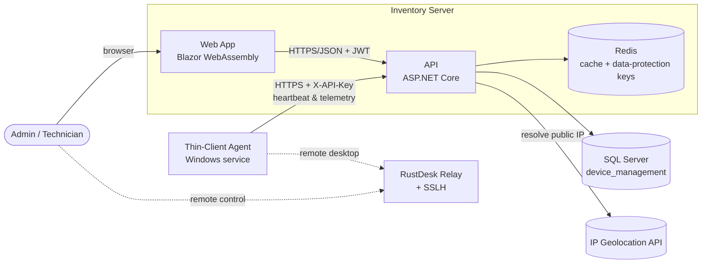
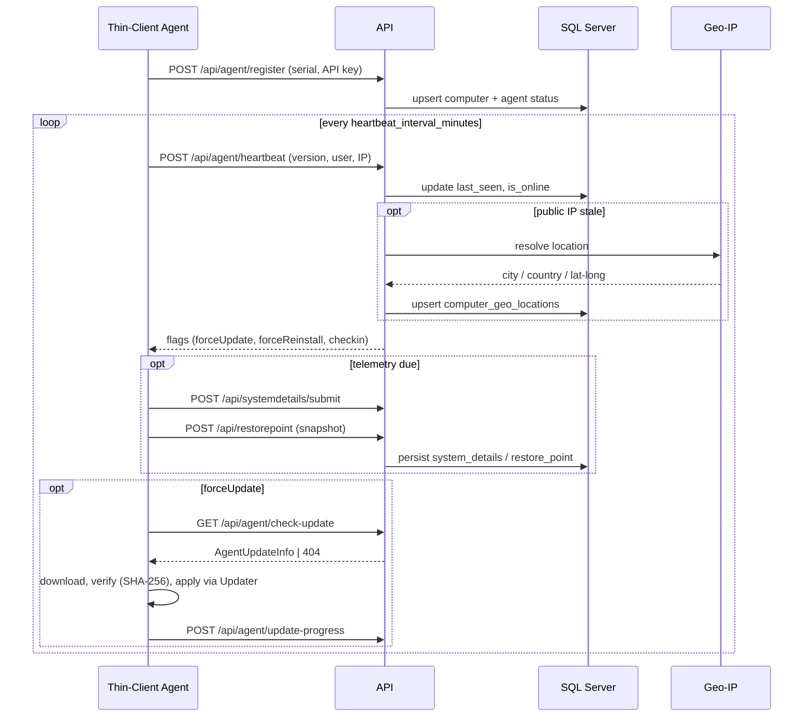
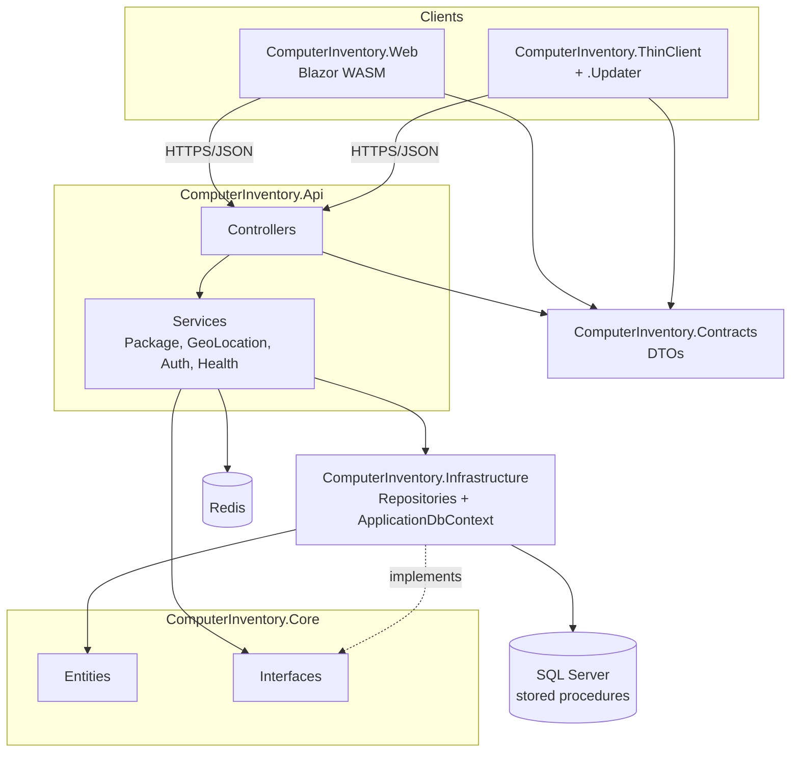
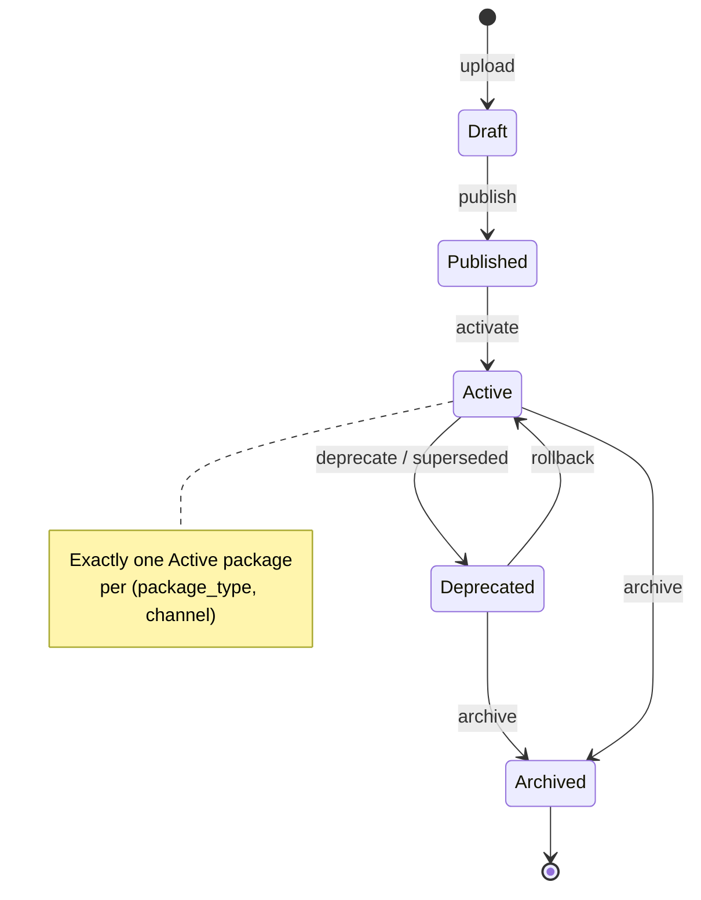
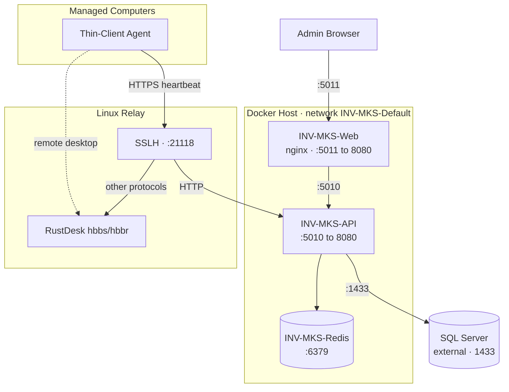

# Diagrams

> **Status:** 🟢 Complete · **Owner:** Engineering · **Last updated:** 2026-07-14
>
> Prefer **text-based diagrams** (Mermaid) so they live in version control and
> diff cleanly. Export images only when needed for external audiences.

## System Context

## Sequence — Agent Check-in & Telemetry

## Component Diagram

Clean-architecture layers; `Contracts` (DTOs) is shared by the Web app and agent.

## State Machine — Package Version Lifecycle

## Deployment Diagram

## Diagram Index

| Diagram | Purpose | Source |
|---------|---------|--------|
| System Context | Actors, apps, and external dependencies | this file |
| Sequence — Agent Check-in | Register → heartbeat → telemetry → update | this file |
| Component | Clean-architecture layers and project references | this file |
| State Machine — Package Lifecycle | Package version status transitions | this file |
| Deployment | Docker services, relay, and agent topology | this file |
| Auto-Update flow | Package resolve/download/apply detail | [technical-design.md](technical-design.md) |
| ER diagram | Database entities and relationships | [data-model.md](data-model.md) |
