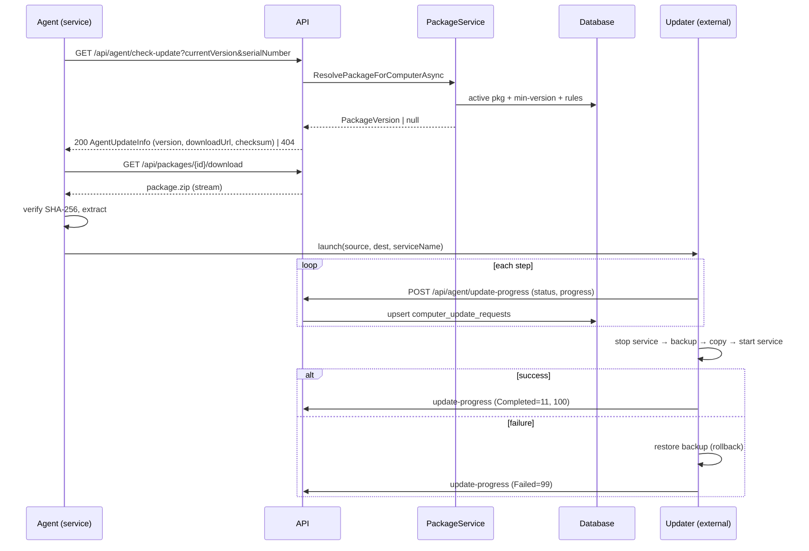

# Technical Design Document

> **Status:** 🟢 Complete · **Owner:** Engineering · **Last updated:** 2026-07-14
>
> One design doc per significant feature or subsystem. Copy this template.

## Feature: Agent Auto-Update & Package Distribution

## 1. Overview

Thin-client agents run unattended as a Windows service on managed computers and
must be upgraded remotely without physical access. This subsystem provides a
**centralized, versioned package registry** on the server and a **self-updating
agent** that downloads, verifies, and applies updates via an external updater
process — with checksum verification, backup/rollback, and targeted rollout.

It replaces the original single-`update.json`-file-on-disk model (still supported
as a fallback) with a database-backed registry supporting multiple versions,
distribution channels, and rollback. Driven by the remote-management
[user stories](../phase-1-inception/user-stories.md).

## 2. Goals & Non-Goals

- **Goals:**
  - Push a new agent version to all or a targeted subset of computers.
  - Guarantee integrity (SHA-256) and safe apply (backup + rollback on failure).
  - Report live per-computer update progress to the server UI.
  - Support staged lifecycle (Draft → Active) and instant rollback.
  - Survive updating the running executable itself and server outages (URL failover).
- **Non-Goals:**
  - Updating the server/API or Web app (separate deployment pipeline).
  - Delta/binary-diff patching — packages are full self-contained zips.
  - OS-level or third-party software patching (that is inventory data only).

## 3. Proposed Design

The agent (`InventoryAgentWorker`) periodically calls `check-update`. The server's
`PackageService.ResolvePackageForComputerAsync` decides the target version by
comparing versions, enforcing `MinimumAgentVersion`, and matching distribution
rules. The agent downloads the package from the registry, verifies the checksum,
extracts it, and launches the standalone **Updater** executable. The Updater runs
outside the service so it can replace every file (including the main `.exe`): it
stops the service, backs up the current install, copies new files, restarts the
service, and rolls back on failure — reporting progress at each step.

Key modules:

- Registry: [PackageVersion.cs](../../src/ComputerInventory.Core/Entities/PackageVersion.cs),
  [PackageService.cs](../../src/ComputerInventory.Api/Services/PackageService.cs),
  [PackagesController.cs](../../src/ComputerInventory.Api/Controllers/PackagesController.cs).
- Agent-facing endpoints: [AgentController.cs](../../src/ComputerInventory.Api/Controllers/AgentController.cs).
- Agent client: [UpdateService.cs](../../src/ComputerInventory.ThinClient/Services/UpdateService.cs),
  [InventoryAgentWorker.cs](../../src/ComputerInventory.ThinClient/InventoryAgentWorker.cs).
- Apply/rollback: [Updater/Program.cs](../../src/ComputerInventory.ThinClient.Updater/Program.cs).
- Build: [build-update-package.ps1](../../build-update-package.ps1).

Package lifecycle: `Draft(0) → Published(1) → Active(2) → Deprecated(3) →
Archived(4)`; exactly one **Active** package per `(package_type, channel)`.
Rollback re-activates a prior version. Channels: `stable`, `beta`, `canary`.
Distribution rules: `AllComputers`, `BySerialNumber`, `ByDepartment`, `ByLocation`
(no rules = all computers). An admin can also force an update/reinstall per
computer via `computer_agent_statuses` flags surfaced on the next heartbeat.

## 4. Data Model Changes

See [Data Model](data-model.md) §3.9 and §3.4. Core entities:

- **`package_versions`** — registry row: `version`, `package_type`, `file_name`,
  `storage_path`, `checksum`, `file_size`, `status`, `channel`, `is_required`,
  `is_breaking_change`, `minimum_agent_version`, `download_count`; UNIQUE
  `(version, package_type)`.
- **`package_distribution_rules`** — `rule_type`, `target_value`, `is_enabled`;
  FK → `package_versions` (`ON DELETE CASCADE`).
- **`computer_update_requests`** — per-computer progress log: `update_status_id`
  (FK → `update_statuses`), `update_progress`, `update_status_message`,
  `update_error_logs`, `previous_agent_version`.
- **`computer_agent_statuses`** flags — `force_update`, `force_reinstall`,
  `reinstall_attempted`, `active_update_request_id`.
- **`update_statuses`** lookup values: `None(0)`, `Pending(1)`,
  `CheckingForUpdate(2)`, `Downloading(3)`, `Verifying(4)`, `Extracting(5)`,
  `PreparingUpdater(6)`, `StoppingService(7)`, `BackingUp(8)`, `CopyingFiles(9)`,
  `StartingService(10)`, `Completed(11)`, `Failed(99)`.

Introduced by migration `009_AddPackageVersioning.sql`
([server/migrations/](../../server/migrations)).

## 5. API Changes

See [API Specification](api-specification.md). Endpoints:

| Method | Route | Auth | Purpose |
|--------|-------|------|---------|
| POST | /api/packages/upload | AdminOnly | Upload zip + metadata (Draft) |
| GET | /api/packages | AdminOnly | List versions |
| GET | /api/packages/{id} | AdminOnly | Detail + rules |
| PUT | /api/packages/{id} | AdminOnly | Edit metadata |
| DELETE | /api/packages/{id} | AdminOnly | Soft-delete |
| POST | /api/packages/{id}/publish · /activate · /deprecate · /rollback | AdminOnly | Lifecycle transitions |
| POST · DELETE | /api/packages/{id}/rules[/{ruleId}] | AdminOnly | Manage distribution rules |
| GET | /api/packages/resolve | Agent | Resolve target version |
| GET | /api/packages/{id}/download | Agent | Download package (increments count) |
| GET | /api/agent/check-update | Agent | Resolve update (registry → `update.json` fallback) |
| GET | /api/agent/download-update | Agent | Legacy package download |
| POST | /api/agent/update-progress | Agent | Report Updater progress/status |

## 6. Alternatives Considered

| Option | Pros | Cons | Chosen? |
|--------|------|------|---------|
| DB package registry + external updater | Multi-version, rollback, targeting, self-exe update | More moving parts | ✅ |
| Single `update.json` + zip on disk | Simple | No history/targeting/rollback; can't replace running exe cleanly | ❌ (kept as fallback) |
| In-process self-update | No extra binary | Cannot overwrite the running executable; risky | ❌ |
| Third-party (MSIX / Squirrel / WinGet) | Off-the-shelf | Heavy for a headless SYSTEM service; less control over rollout/telemetry | ❌ |

Lifecycle/rollback trade-offs recorded as an [ADR](adr/README.md).

## 7. Security & Privacy Considerations

- **Authz:** all admin package operations require the `AdminOnly` policy; agent
  endpoints authenticate via `X-API-Key` + `X-Agent-Session-Id`.
- **Integrity:** SHA-256 checksum verified by the agent before extraction; the
  Updater runs in **SYSTEM** context — packages must come only from the trusted
  server. Upload size is capped (200–500 MB) to limit abuse.
- **Least privilege:** install-script access is gated by short-lived, single-use
  `install_tokens`; API keys are claimed once via `claim-api-key`.
- **Privacy:** packages contain no PII; progress logs carry version strings only.
- See [Threat Model](../security/threat-model.md). Open risk: package signing (below).

## 8. Performance & Scalability

- `check-update` and `resolve` are lightweight indexed lookups
  (`ix_package_versions_status_type`, `_channel_type`); the active package is a
  hot read and cacheable.
- Downloads stream from disk; `download-update` strips invalid `Range` headers to
  avoid repeated 416s from stale partial downloads on older agents.
- Rollout is naturally throttled by staggered heartbeat intervals
  (`heartbeat_interval_minutes`); distribution rules enable phased ramp.

## 9. Observability

- Structured logs across resolve/check/download/apply (server) and
  `C:\ProgramData\ComputerInventory\updater.log` (client).
- `computer_update_requests` provides per-computer status/progress; the Web
  dashboard aggregates via `PackageService.GetDistributionSummaryAsync`
  (`ComputersAtLatest / PendingUpdate / Updating` + version distribution).
- `AgentPackageHealthCheck` reports package availability in `/api/health`.
- `DownloadCount` per package tracks adoption.

## 10. Rollout & Migration Plan

- **Feature flag:** `AgentSettings:EnableAutoUpdate` (client) toggles the whole flow.
- **Phased rollout:** publish to `beta`/`canary` channel or a `BySerialNumber`/
  `ByDepartment` rule first, then widen to `stable`/`AllComputers`.
- **Backfill:** legacy `update.json` remains as a fallback path, so existing
  agents keep updating during migration.
- **Rollback:** `POST /api/packages/{id}/rollback` re-activates a prior version;
  on-device, the Updater restores its pre-update backup automatically on failure.
- **Reinstall path:** `force_reinstall` returns `ReinstallRequired=true` +
  `InstallScriptUrl` for agents below `minimum_agent_version`.

## 11. Testing Strategy

See [Test Plan](../phase-4-testing/test-plan.md).

- **Unit:** `ResolvePackageForComputerAsync` (version compare, min-version gate,
  rule matching, no-rules=all); lifecycle transitions; checksum verification.
- **Integration:** upload → publish → activate → resolve → download round-trip;
  rollback re-activates prior version; `update-progress` upserts requests.
- **E2E (staged VM):** real Updater run — stop/backup/copy/restart, induced
  failure triggers rollback, and self-executable replacement succeeds.
- **Resilience:** server-URL failover; interrupted/partial download recovery.

## 12. Open Questions

- Should packages be **cryptographically signed** (beyond checksum) so agents can
  verify authenticity independent of transport trust?
- Automatic rollback trigger server-side when a version's `Failed` rate crosses a
  threshold?
- Retention/pruning policy for `Archived` packages and their stored zip files.
