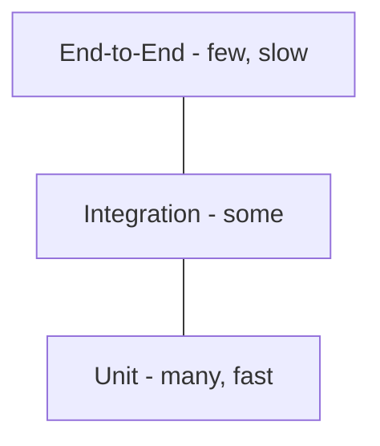

# Test Plan & Strategy

> **Status:** 🟢 Complete · **Owner:** Engineering · **Last updated:** 2026-07-14

## 1. Objectives

Assure that ComputerInventory meets its
[SRS](../phase-1-inception/software-requirements-specification.md) functional
(FR-1..18) and non-functional (NFR-1..10) requirements: correct inventory and
agent behavior, enforced auth/RBAC, reliable agent auto-update, and no data loss
when the server is unreachable. "Done" = all Must-priority features covered by
green automated tests in CI, no open Critical/High defects, and coverage targets
met on changed code.

## 2. Scope

- **In scope:** API controllers/services, repositories over the 100+ stored
  procedures, auth/JWT + RBAC, agent register/heartbeat/offline detection, the
  package + auto-update lifecycle and `Updater.exe` apply/rollback, inventory
  CRUD/search/export, loaner lifecycle, maintenance, and audit logging.
- **Out of scope:** third-party infrastructure (SQL Server engine, Redis,
  RustDesk relay), browser/OS internals, and load/soak testing beyond the NFR
  targets in §4 (tracked separately).

## 3. Test Levels (The Test Pyramid)

| Level | What it checks | Tooling | Owner |
|-------|----------------|---------|-------|
| Unit | Domain logic, validators, and services in isolation | xUnit; mocks / `NullLogger` | Devs |
| Integration | Repositories + stored procedures against a real SQL Server | xUnit + Testcontainers.MsSql (SQL Server 2022), `DatabaseFixture`, `TestDataSeeder` | Devs |
| End-to-End | Full flows Web → API → DB, agent install/update | Manual against the Compose stack (Playwright candidate) | QA/Devs |
| Manual / Exploratory | Usability, agent install, updater rollback | — | QA |

> Because data access is dominated by stored procedures, the pyramid is
> intentionally **integration-heavy**: tests run against a real SQL Server engine
> (not the in-memory provider) so SQL behavior, paging, and cascades are exercised.

## 4. Test Types

- **Functional** — meets requirements; see the [Test Cases](test-cases.md) (TC-001..026).
- **Regression** — the full suite runs in CI on every PR to `main`.
- **Performance / Load** — [NFR](../phase-1-inception/software-requirements-specification.md#4-non-functional-requirements) targets: dashboard p95 < 500 ms for 200+ devices (NFR-1), ≥ 200 agents / 500+ records (NFR-3).
- **Security** — see [Threat Model](../security/threat-model.md): auth/authz negatives (TC-002/003/004/015), rate-limit lockout, TLS, agent API key, SHA-256 update verification.
- **Accessibility** — WCAG 2.1 AA (NFR-7).
- **Compatibility** — Blazor WASM on current Chromium/Firefox/Edge; Windows Service agent on Windows 10/11 + Server.

## 5. Environments

| Environment | Purpose | Config | Data |
|-------------|---------|--------|------|
| Local | Dev testing / debugging | `docker-compose.dev.yml` (SQL 2025 :14330, Redis :6379); API :5000, Web :5001; `admin`/`Admin123!` | Synthetic seed |
| CI | Automated gate | GitHub Actions; Testcontainers SQL Server 2022 (ephemeral) | Seeded via `TestDataSeeder`, torn down per class |
| Staging | Pre-prod validation | `docker-compose.yml` (INV-MKS-* containers), external SQL Server | Prod-like (anonymized) |
| Production | Live monitoring | Same Compose; see [Monitoring](../phase-6-operations/monitoring.md) | Real |

## 6. Entry & Exit Criteria

- **Entry:** solution builds in Release; migrations 001–048 apply cleanly;
  dependencies (SQL Server, Redis) reachable; feature code complete.
- **Exit:** all Must-priority FR cases pass; both CI jobs green (NFR-8); no open
  Critical/High defects; coverage target met on changed code.

## 7. Coverage Goals

- Line/branch target **80%** on `Core` / `Infrastructure` / `Api` business logic
  (measured by coverlet).
- **Critical paths 100%** covered by ≥ 1 automated or documented manual case:
  login/authz, agent register + heartbeat, package resolve/download, and updater
  apply/rollback.
- Excluded: generated DDL, DTOs, and `Program.cs` startup wiring.

## 8. Test Data Management

Integration data is seeded by `TestDataSeeder` (serials `SN-001`…) into a fresh
Testcontainers database; each test class cleans up in `DisposeAsync` using an
ordered `DELETE` cascade. No production data is used in tests — local runs on the
synthetic seed and staging on anonymized copies. Secrets come from environment
variables / `dotnet user-secrets` and are never committed or echoed to logs.

## 9. Automation & CI

Defined in [`.github/workflows/ci.yml`](../../.github/workflows/ci.yml), triggered
on push/PR to `main` and `workflow_dispatch` (superseded runs auto-cancel):

| Job | Runner | Command |
|-----|--------|---------|
| Build & Unit Tests | `windows-latest` | `dotnet build` then `dotnet test … --filter 'FullyQualifiedName!~ComputerInventory.Tests.Integration'` |
| Integration Tests | `ubuntu-latest` | `dotnet test src/ComputerInventory.Tests … --filter 'FullyQualifiedName~ComputerInventory.Tests.Integration'` (Docker SQL Server) |

Both jobs are required to merge. See [CI/CD](../phase-5-deployment/ci-cd.md).

## 10. Defect Management

Log defects with the [Bug Report template](bug-report-template.md). Severity S1
(Critical) → S4 (Trivial); priority P1 → P3. Triage on each PR and at the weekly
review; **S1/S2 block release**. Every fix links a regression test or documents
why one is not feasible.

## 11. Risks & Contingencies

| Risk | Mitigation |
|------|------------|
| SignalR update-progress hub has no Redis backplane (scale-out gap) | Test single-instance; document the limitation; load-test before multi-node |
| Integration suite depends on Docker/Testcontainers | Pin the SQL image; run on the Linux runner; fail fast if Docker is unavailable |
| Stored-proc-heavy data layer — EF mocks miss real SQL behavior | Prefer integration tests on a real engine over the in-memory provider |
| Updater runs as SYSTEM; destructive paths are hard to test | Exercise rollback in a VM/sandbox; SHA-256 verify + backup before copy |
| Flaky E2E from async agent timing (heartbeat / offline threshold) | Use deterministic polling and configurable thresholds in test config |
