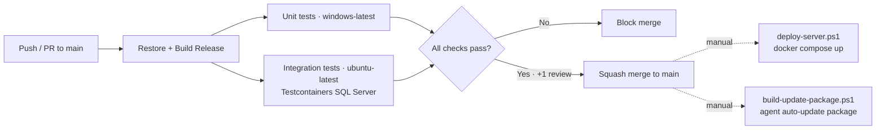

# CI/CD Pipeline

> **Status:** 🟢 Complete · **Owner:** Engineering · **Last updated:** 2026-07-14

## 1. Overview

CI runs on **GitHub Actions** ([.github/workflows/ci.yml](../../.github/workflows/ci.yml))
with a fail-early, parallel philosophy: every push and PR to `main` builds the
solution once in Release and runs the test suite split across two runners.
Deployment is **script-driven** (PowerShell over SSH + Docker Compose) and
operator-initiated — no automated deploy is wired into Actions yet.

## 2. Pipeline Stages

## 3. Continuous Integration

Triggered on push/PR to `main` and `workflow_dispatch`. SDKs 8.0.x + 9.0.x are
installed (`global.json` pins 9.0; projects target `net8.0`).

| Stage | Command | Runner | Fails build on |
|-------|---------|--------|----------------|
| Restore | `dotnet restore ComputerInventory.sln` | windows | Restore error |
| Build (+ Roslyn analyzers) | `dotnet build ComputerInventory.sln -c Release --no-restore` | windows | Build error |
| Unit tests | `dotnet test … --filter 'FullyQualifiedName!~ComputerInventory.Tests.Integration'` | windows | Any test failure |
| Integration tests | `dotnet test src/ComputerInventory.Tests/… --filter 'FullyQualifiedName~ComputerInventory.Tests.Integration'` | ubuntu | Any test failure |

- **Windows runner** builds the whole solution (Windows-Service ThinClient agent + Blazor WASM web).
- **Ubuntu runner** runs integration tests; Testcontainers boots an ephemeral `mcr.microsoft.com/mssql/server` container per run.
- Coverage via `coverlet`, 80% target on changed lines (see [test-plan](../phase-4-testing/test-plan.md)) — not yet a hard CI gate.
- SAST / dependency scanning: **not configured** — candidate improvement (CodeQL + Dependabot).

## 4. Continuous Delivery/Deployment

No auto-deploy from CI; releases are cut manually from `main`:

| Trigger | Action |
|---------|--------|
| PR to `main` | Run CI (build + unit + integration); no deploy |
| Merge to `main` | Operator runs `deploy-server.ps1` → SCP over SSH → rebuild/restart the Docker Compose stack |
| Agent release | `build-update-package.ps1 -Version x.y.z.w` → zip → upload via Packages admin API for staged auto-update (channels stable/beta/canary) |

Server stack: `INV-MKS-API` (:5010), `INV-MKS-Web` (:5011, nginx), `INV-MKS-Redis`;
SQL Server is external. See the [Deployment Guide](deployment-guide.md).

## 5. Secrets in CI

- CI currently needs **no secrets** — build/test are read-only and Testcontainers provisions its own throwaway SQL password.
- Deploy-time secrets (DB credentials, agent API key, SA password) live in the server's `.env` (from `server/.env.example`) — never in the repo.
- If CD is added, store credentials in GitHub **Environments → secrets**, scoped per environment; never echo them to logs.

## 6. Caching & Performance

- `concurrency: cancel-in-progress` cancels superseded runs on the same ref.
- The two test jobs run in parallel; `--no-restore` / `--no-build` avoid redundant work on the Windows job.
- NuGet layer caching is **not yet** configured (candidate: `actions/cache` or `setup-dotnet` cache).
- Target pipeline duration: **< 10 minutes**.

## 7. Quality Gates

A change cannot merge to `main` unless:

- [ ] `Build & Unit Tests` check passes
- [ ] `Integration Tests (SQL Server)` check passes
- [ ] ≥ 1 approving review (protected branch, squash merge)
- [ ] Branch up to date, no unresolved conversations
- [ ] Coverage target (80% changed lines) met — goal, tracked via `coverlet`

## 8. Pipeline as Code

The pipeline is defined in [.github/workflows/ci.yml](../../.github/workflows/ci.yml)
and reviewed like any other code via PR. See the
[Git Workflow](../phase-3-development/git-workflow.md).

## 9. Notifications

- GitHub reports per-job **status checks** on the PR/commit; failures email the triggering author.
- No Slack/Teams webhook is configured — candidate improvement for release visibility.
