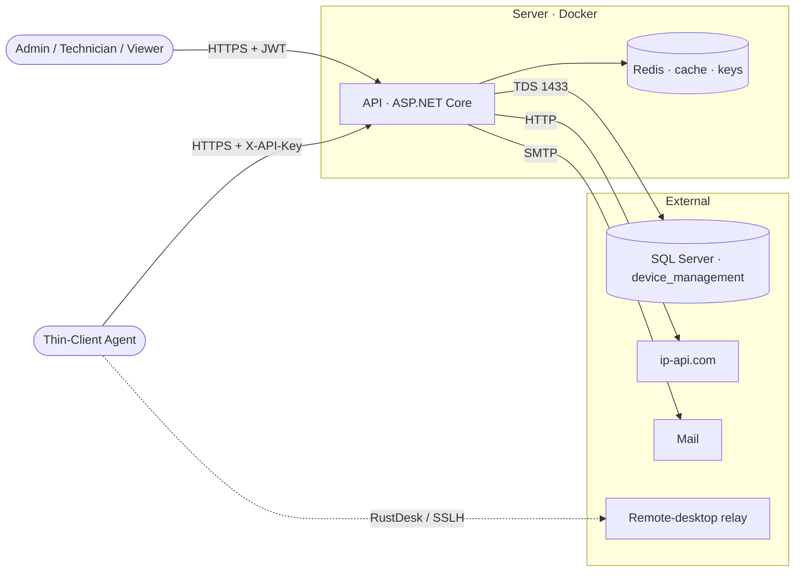

# Threat Model

> **Status:** 🟢 Complete · **Owner:** Engineering · **Last updated:** 2026-07-14
>
> Security risks for the Computer Inventory Management System, modeled with
> [STRIDE](https://en.wikipedia.org/wiki/STRIDE_model) and the
> [OWASP Top 10](https://owasp.org/www-project-top-ten/). See the
> [Architecture](../phase-2-design/architecture.md) for system detail and
> [SECURITY.md](../../SECURITY.md) for the reporting process.

## 1. Scope & Assets

A self-hosted ASP.NET Core **API**, a Blazor WASM **Web** app, and unattended Windows
**thin-client agents** (see [Architecture](../phase-2-design/architecture.md)).

| Asset | Sensitivity | Notes |
|-------|-------------|-------|
| Credentials & secrets | Critical | BCrypt password hashes, JWT signing key (`JwtSettings:SecretKey`), agent shared `X-API-Key`, DB connection string, DataProtection keyring |
| Staff account PII | High | Username, email, name, department, role — used for auth, RBAC, and audit attribution |
| Agent update packages | High | Unsigned `.zip` applied by a SYSTEM-context updater → an integrity failure risks fleet-wide RCE |
| Remote-desktop access | High | RustDesk relay brokers interactive control of managed computers |
| Device inventory & telemetry | Medium | Serial, hostname, MAC, IP, geolocation, 16 system-detail facets |
| Audit logs & histories | Medium | `audit_log` / `computer_histories` — integrity & accountability |

## 2. System Overview & Trust Boundaries

Reference the [Architecture](../phase-2-design/architecture.md). Trust boundaries are
crossed at the browser, the NAT'd agent fleet, and every external dependency.

- **Browser → API:** untrusted client; all authorization enforced server-side; JWT in an httpOnly cookie or `Authorization` header.
- **Agent → API:** semi-trusted, behind NAT (pull-only heartbeat); authenticates with a shared static `X-API-Key`.
- **API → SQL Server / Redis / SMTP / ip-api.com / relay:** each is an external trust boundary.

## 3. Threats (STRIDE)

| Category | Threat | Asset | Likelihood | Impact | Mitigation |
|----------|--------|-------|-----------|--------|------------|
| **S**poofing | Stolen/forged JWT, or agent impersonation via a leaked shared `X-API-Key` | Credentials | M | H | HMAC-SHA256 JWT (issuer/audience/lifetime validated, 1-min skew); httpOnly + Secure + `SameSite=Strict` cookies; refresh-token rotation; BCrypt + `LoginRateLimiter` lockout. *Gap: single shared agent key (§6)* |
| **T**ampering | Malicious agent update package, or in-transit request/response modification | Update packages | L | H | HTTPS + HSTS; SHA-256 verification + backup/rollback in the updater. *Gap: packages unsigned (§6)* |
| **R**epudiation | User or agent denies performing an action | Audit logs | L | M | `audit_log` + `computer_histories`; Serilog request logging with correlation id, client IP, and authenticated user |
| **I**nfo disclosure | Leak of PII, secrets, or device IPs (incl. cleartext geo lookup) | PII / secrets | M | H | RBAC + per-computer scope; secrets validated at startup, never logged; `no-store` on `/api/`; RFC-7807 errors hide internals. *Gap: ip-api.com over HTTP (§6)* |
| **D**enial of service | Credential stuffing or request floods | API availability | M | M | Global + agent-key rate limiting (Redis / in-memory); login lockout; EF retry. Volumetric DoS is out of scope ([SECURITY.md](../../SECURITY.md)) |
| **E**levation of privilege | Viewer/Technician performs an Admin action; access to another department's computer | RBAC | L | H | Role policies (`AdminOnly` / `TechnicianOrAdmin` / `AllUsers`) + `ComputerAuthorizationHandler` (department + ownership); Development-mode-in-container guard |

## 4. OWASP Top 10 Checklist

- [x] A01 Broken Access Control — role policies + per-computer handler enforced server-side
- [x] A02 Cryptographic Failures — TLS + HSTS in transit; BCrypt hashes; HMAC-SHA256 JWT; persisted DataProtection keys (DB at-rest encryption is the deploying org's responsibility)
- [x] A03 Injection — stored procedures + EF Core parameterization; FluentValidation at the boundary
- [x] A04 Insecure Design — threat modeling done (this doc); clean-architecture layering
- [x] A05 Security Misconfiguration — security-headers middleware, fail-fast config validation, no Development mode in container
- [ ] A06 Vulnerable Components — **no automated dependency/SBOM scanning** (no Dependabot/CodeQL) — see §6
- [x] A07 Auth Failures — brute-force lockout, refresh-token rotation, strong password policy (**no MFA** — §6)
- [ ] A08 Data Integrity Failures — updates are SHA-256-verified but **packages are unsigned** — see §6
- [x] A09 Logging/Monitoring — Serilog + audit tables + health probes (see [Monitoring](../phase-6-operations/monitoring.md))
- [ ] A10 SSRF — outbound geo lookups use a configurable URL; **default `http://ip-api.com`** should be HTTPS/allowlisted — see §6

## 5. Security Controls

| Control | Description | Status |
|---------|-------------|--------|
| Authentication | JWT bearer (HMAC-SHA256, ≥32-char key) via header, httpOnly cookie, or SignalR query; refresh-token rotation; agent `X-API-Key` + `X-Agent-Session-Id` | ✅ |
| Authorization | Role policies (`AdminOnly` / `TechnicianOrAdmin` / `AllUsers`) + `ComputerAuthorizationHandler` (department + ownership) | ✅ |
| Encryption | HTTPS redirect + HSTS in transit; BCrypt passwords; DataProtection keyring (Redis / `/app/keys`) | ✅ |
| Secrets management | `.env` / environment variables; fail-fast startup validation; excluded from logs; never returned in responses | ✅ |
| Input validation | FluentValidation DTOs; stored procedures + parameterized EF; request body-size caps | ✅ |
| Rate limiting | Global + per-agent-key partitions (Redis or in-memory); `LoginRateLimiter` brute-force lockout | ✅ |
| Security headers | CSP, HSTS, `X-Content-Type-Options: nosniff`, `X-Frame-Options: DENY`, Referrer/Permissions-Policy, `no-store` on `/api/` | ✅ |
| Audit logging | `audit_log` + `computer_histories`; Serilog with correlation id / client IP / user | ✅ |
| Update integrity | SHA-256 verification + backup/rollback + multi-URL failover (**unsigned** — §6) | ⚠️ |

## 6. Residual Risks & Actions

| Risk | Owner | Action | Due |
|------|-------|--------|-----|
| Agent update packages are unsigned (checksum only) — a compromised server/transport could push fleet-wide RCE | Engineering | Add package code-signing + signature verification in the updater | Next hardening cycle |
| Single shared static agent `X-API-Key` — one leak impersonates any agent, with no rotation | Engineering | Move to per-agent credentials + rotation | Next hardening cycle |
| Default geo provider `http://ip-api.com` — cleartext device IPs + SSRF surface (+ non-commercial ToS) | Engineering | Switch to an HTTPS/self-hosted provider; allowlist the outbound URL | Before commercial prod |
| No automated dependency / SBOM / SAST scanning | Engineering | Add Dependabot + CodeQL + SBOM to [CI](../phase-5-deployment/ci-cd.md) | Next hardening cycle |
| No multi-factor authentication for staff accounts | Engineering | Evaluate MFA / SSO integration | Backlog |
| Default admin credential (`admin` / `admin@inventory.local`) | Deploying org | Rotate on first deploy | At deployment |

## 7. Reporting

Vulnerability reporting process is documented in [SECURITY.md](../../SECURITY.md).
